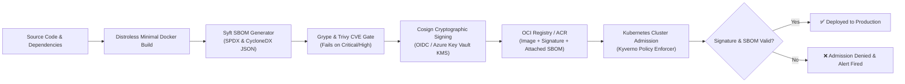

# 🔐 Cloud-Native Supply Chain Security: Syft, Grype & Cosign

[](https://slsa.dev)
[](https://github.com/anchore/syft)
[](https://github.com/anchore/grype)
[](https://sigstore.dev)
[](https://learn.microsoft.com)

Production implementation of modern **Software Supply Chain Security (SSDF / SLSA Level 3)** by **Gunjan Kumar Gaurav** (Senior Cloud & DevSecOps Consultant).

> 📈 **Measurable Business Impact:**  
> By integrating automated **Syft SBOM generation** and **Cosign cryptographic artifact signing** into build pipelines, our cloud environment compliance score tracked through **Microsoft Defender for Cloud surged from 65% to 85% within two quarters**.

---

## 🏛️ End-to-End Trust Chain Architecture



---

## 🛠️ Security Framework Tools

| Component | Tool | Standard | Enforcement |
|---|---|---|---|
| **SBOM Engine** | `Anchore Syft` | SPDX 2.3 & CycloneDX 1.5 JSON | Generated on every build |
| **Vulnerability Analysis** | `Anchore Grype` + `Aqua Trivy` | NVD, GHSA, CVE databases | Blocks on CVSS >= 7.0 |
| **Artifact Signing** | `Sigstore Cosign` | Keyless OIDC / Azure Key Vault KMS | Mandatory signature tag |
| **Cluster Admission** | `Kyverno ClusterPolicy` | Zero Trust Pod Admission | Rejects unsigned pods |
| **Compliance Tracking** | `Microsoft Defender for Cloud` | NIST SP 800-218 SSDF | Secure Score Metric |

---

## 📂 Repository Layout

```text
├── azure-pipelines-supply-chain.yml   # Multi-stage Azure DevOps supply chain pipeline
├── .github/workflows/
│   └── supply-chain-security.yml      # GitHub Actions equivalent workflow
├── docker/
│   └── Dockerfile                     # Distroless multi-stage hardened container
├── policies/
│   ├── kyverno-verify-signature.yaml  # Cluster admission rule enforcing signature
│   └── kyverno-require-sbom.yaml      # Cluster admission rule enforcing SBOM attestation
├── scripts/
│   ├── generate-and-sign.sh           # Local pipeline execution utility
│   └── verify-artifact.sh             # Cosign verification script
└── README.md
```

---

## 💻 Quickstart: Local Execution

Generate an SBOM and sign an artifact locally:

```bash
chmod +x scripts/*.sh
./scripts/generate-and-sign.sh my-app:v1.0.0
```

Verify signature integrity before deployment:

```bash
./scripts/verify-artifact.sh my-app:v1.0.0
```

---

## 👤 Author
**Gunjan Kumar Gaurav**  
*Senior Cloud & DevSecOps Consultant*  
[LinkedIn Profile](https://linkedin.com/in/gunjan-gaurav) • [GitHub](https://github.com/gunjankumargaurav7350)
